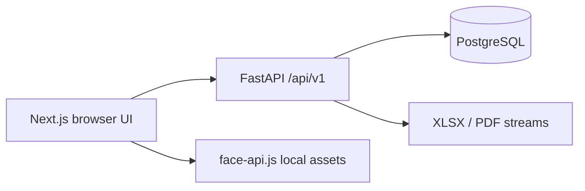

# Architecture

## System shape

The frontend is a Next.js client application. It keeps access tokens in memory and calls the FastAPI REST API. A rotating refresh token is stored in an HttpOnly cookie scoped to `/api/v1/auth`.

FastAPI owns all authorization decisions. SQLAlchemy models and an Alembic migration define the relational schema; at startup the API runs Alembic via `run_database_migrations()` before `verify_database_readiness()`, which only checks the result. Business logic lives in service modules rather than endpoint handlers.

## Core data model

- `users`, `students`, `professors`, `departments`
- `courses`, `classes`, `enrollments`, `schedules`, `classrooms`
- `face_embeddings`, `biometric_consents`
- `attendance_sessions`, `attendance_records`, `qr_token_usages`
- `refresh_tokens`, `audit_logs`

Important constraints:

- `users.email`, `students.university_id`, and `professors.employee_id` are unique.
- `enrollments` are unique per `(student_id, class_id)`.
- `schedules` are unique per `(class_id, day_of_week, start_time)`; admins own weekly timetable CRUD and students receive a read-only projection.
- `attendance_records` are unique per `(session_id, student_id)`.
- `qr_token_usages` are unique per `(session_id, token_hash, student_id)`.
- Foreign keys connect attendance to sessions, students, classes, courses, professors, and classrooms.
- Indexes cover common report and dashboard filters.

## QR flow

1. Professor starts a scheduled session.
2. Backend generates `uat:v1:<random>`, stores only its SHA-256 hash and expiry, and returns the payload to the professor.
3. The professor UI renders the payload as a QR code.
4. Student scans it, grants geolocation, and submits the token plus coordinates.
5. Backend checks token hash, expiry, session state, enrollment, one-use enforcement, and distance from the classroom.
6. Backend creates one `attendance_records` row and returns present/late status.
7. Refresh generates a new token and invalidates the prior token. Closing clears the active token and marks absent students.

## Face flow

1. Student grants camera permission and explicitly consents to the current biometric policy version. An admin may capture on a student's behalf only by recording `consent_confirmed` and a consent reference that is written to the audit log.
2. Browser uses locally hosted `face-api.js` assets to detect a face, generate 128-d descriptors, and record face-center positions for the active movement challenge.
3. Browser sends only descriptor vectors and centers. The API validates vector shape, frame count, and movement, then checks consent and enrollment.
4. Descriptors are compared against other registered students to prevent duplicates, then encrypted with Fernet and stored.
5. For check-in, the API requires active consent, the session's configured challenge, required location verification, an active session, enrollment, and a match above the configured cosine threshold.
6. Raw camera frames never leave the browser. A daily retention task purges old descriptors and revokes consent when no descriptors remain.

Liveness is intentionally a heuristic: frame count, single-face detection, and movement. It reduces casual spoofing but cannot guarantee prevention of a determined replay or injection attack. Professor-supervised sessions and the manual correction path remain part of the design.

## Authorization

- Admin: system-wide management, weekly timetable CRUD, audited face enrollment on behalf of students, and reports.
- Professor: CRUD only for assigned classes/sessions, live rosters, and audited corrections.
- Student: self-registration, self check-ins, and read-only access to their own attendance.

Students cannot create records for other students and cannot edit or correct attendance. All mutation endpoints verify ownership or self identity server-side.

## Auditing

Audit entries record actor, action, entity, before/after JSON, reason, IP, and user agent for registration, biometric changes, session lifecycle events, absent marking, and attendance corrections. IP extraction trusts forwarding headers only from configured proxy addresses.

## Deployment

Production requires PostgreSQL, HTTPS, unique secrets, constrained CORS origins, a trusted proxy configuration, and a shared rate-limit store when running multiple instances. `DATABASE_URL` must be set to the production PostgreSQL database used at runtime; if it is missing or wrong, startup fails with a config/migration error. The provided Compose stack is for local development and a deployment reference; it includes startup migrations, conditional development seeding, and persistent database storage.

The Docker/Render command no longer runs the Alembic CLI before Uvicorn. Uvicorn startup calls `run_database_migrations()` in `backend/app/main.py`, applying migrations with the same `DATABASE_URL` as the running API; `verify_database_readiness()` runs afterward only as a check. Vercel no longer runs `alembic upgrade head` as a build command (`vercel.json` uses an echo build command), because build-time migrations targeted a different/ephemeral database and caused `Database has not been migrated` at runtime. The container uses `PORT` when supplied by the host. Both Compose and Vercel install only `backend/requirements.txt`; no Python face-model stack is needed because recognition runs in the browser. The legacy `face_model_unavailable` error is no longer part of the API contract.

On Vercel, when `backend/app/main.py` is imported by `vercel_runtime.vc_init`, it attaches a module-level `vc_handler` proxy to `sys.modules["vercel_runtime.vc_init"]` to satisfy the generated `/var/task/vc__handler__python.py` import. The handler invokes the FastAPI app directly via `httpx.ASGITransport` instead of proxying to Vercel's short-lived local Uvicorn thread, and runs startup migrations/readiness once per invocation process. No `sitecustomize.py`, no `includeFiles`, and no `VERCEL_IPC_PATH` clearing are needed; development/preview are unaffected because `vercel_runtime.vc_init` is not present.
