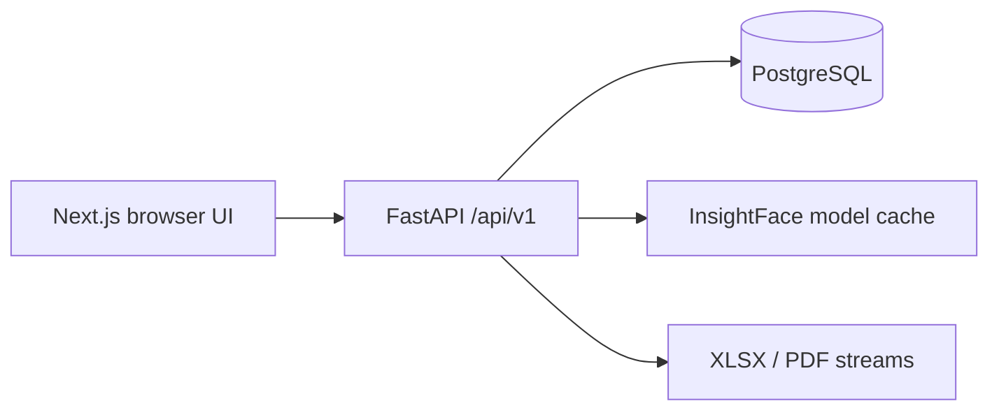

# Architecture

## System shape

The frontend is a Next.js client application. It keeps access tokens in memory and calls the FastAPI REST API. A rotating refresh token is stored in an HttpOnly cookie scoped to `/api/v1/auth`.

FastAPI owns all authorization decisions. SQLAlchemy models and an Alembic migration define the relational schema. Business logic lives in service modules rather than endpoint handlers.

## Core data model

- `users`, `students`, `professors`, `departments`
- `courses`, `classes`, `enrollments`, `schedules`, `classrooms`
- `face_embeddings`, `biometric_consents`
- `attendance_sessions`, `attendance_records`, `qr_token_usages`
- `refresh_tokens`, `audit_logs`

Important constraints:

- `users.email`, `students.university_id`, and `professors.employee_id` are unique.
- `enrollments` are unique per `(student_id, class_id)`.
- `attendance_records` are unique per `(session_id, student_id)`.
- `qr_token_usages` are unique per `(session_id, token_hash, student_id)`.
- Foreign keys connect attendance to sessions, students, classes, courses, professors, and classrooms.
- Indexes cover common report and dashboard filters.

## QR flow

1. Professor starts a scheduled session.
2. Backend generates `uat:v1:<random>`, stores only its SHA-256 hash and expiry, and returns the payload to the professor.
3. The professor UI renders the payload as a QR code.
4. Student scans it, grants geolocation, and submits the token plus coordinates.
5. Backend checks token hash, expiry, session state, enrollment, one-use enforcement, and distance from the classroom.
6. Backend creates one `attendance_records` row and returns present/late status.
7. Refresh generates a new token and invalidates the prior token. Closing clears the active token and marks absent students.

## Face flow

1. Student grants camera permission and explicitly consents to the current biometric policy version.
2. Browser captures multiple compressed frames while prompting an active movement challenge.
3. Backend decodes frames in memory, requires exactly one face per frame, detects movement, and computes normalized embeddings using InsightFace.
4. Embeddings are compared against all other registered students to prevent duplicates, then encrypted with Fernet and stored.
5. For check-in, the backend requires active consent, the session's configured challenge, required location verification, an active session, enrollment, and a match above the configured cosine threshold.
6. Raw images are never persisted. A retention task purges old embeddings and revokes consent when no embeddings remain.

Liveness is intentionally a heuristic: frame count, single-face detection, and movement. It reduces casual spoofing but cannot guarantee prevention of a determined replay or injection attack. Professor-supervised sessions and the manual correction path remain part of the design.

## Authorization

- Admin: system-wide management and reports.
- Professor: CRUD only for assigned classes/sessions, live rosters, and audited corrections.
- Student: self-registration, self check-ins, and read-only access to their own attendance.

Students cannot create records for other students and cannot edit or correct attendance. All mutation endpoints verify ownership or self identity server-side.

## Auditing

Audit entries record actor, action, entity, before/after JSON, reason, IP, and user agent for registration, biometric changes, session lifecycle events, absent marking, and attendance corrections. IP extraction trusts forwarding headers only from configured proxy addresses.

## Deployment

Production requires PostgreSQL, HTTPS, unique secrets, constrained CORS origins, and a trusted proxy configuration. The provided Compose stack is for local development and a deployment reference; it includes migrations, conditional development seeding, persistent database storage, and a persistent face-model cache.

Vercel uses `backend/requirements.txt` for the public FastAPI service. The InsightFace/ONNX/OpenCV/Numpy stack lives in `backend/requirements-face.txt` and is excluded from the serverless bundle to stay under the 500 MB Python function limit; face endpoints return `503 face_model_unavailable` there. Run the Compose stack or another long-running Python service with both requirements files to enable face features.
